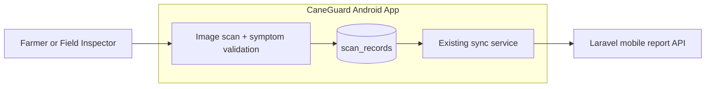
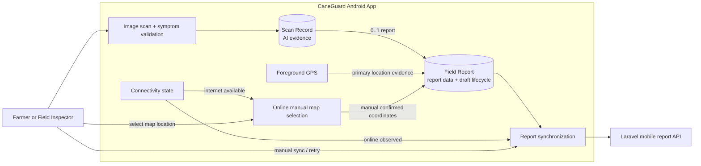
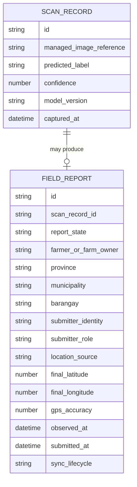
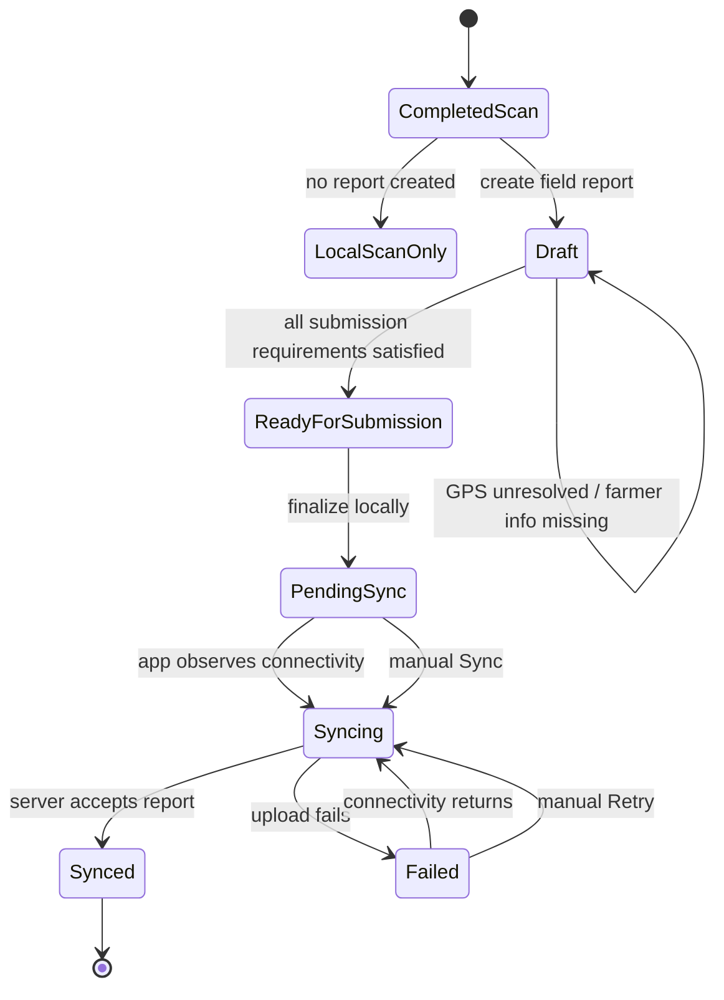
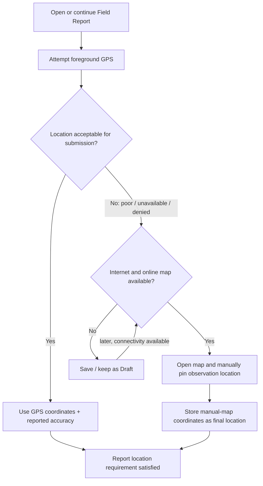
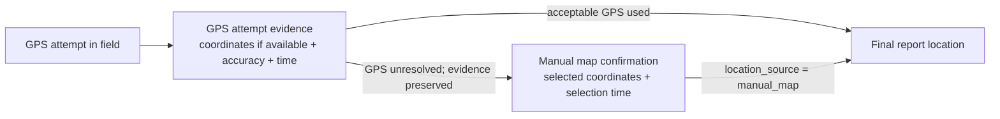

# ADR-0001: Separate Field Reports from AI Scan Records in the Offline-First Mobile Architecture

## ADR at a Glance

**Problem:**  
CaneGuard currently persists an AI scan as the same local record that carries report synchronization state. The follow-up interview established that actual field reporting may remain incomplete while information is still being clarified, and that GPS quality can delay field work. P0 therefore needs a report model that can remain incomplete as a draft, preserve field evidence offline, and later complete its required location either through acceptable GPS evidence or an online manual map pin.

**Decision:**  
Keep the existing AI Scan Record as the durable evidence of one completed AI-supported disease scan, and introduce a separate **Field Report** that references exactly one completed Scan Record. One completed Scan Record may produce at most one Field Report. A Field Report may be saved locally as an incomplete **Draft**. It becomes submit-ready only when all required submission information is satisfied. For location, GPS is the primary source; when GPS cannot provide an acceptable location during field work, the report remains a Draft unless an online manual map pin is used to confirm the location. Finalized reports synchronize automatically when the running app observes restored connectivity and also support manual Sync/Retry.

**Why:**  
The scan and the formal report have different meanings and lifecycles. A scan is an on-device decision-support observation. A Field Report is a structured record that may need additional information before submission. Separating them allows CaneGuard to preserve completed scan evidence immediately, mirror the draft behavior described by SRA staff, and avoid forcing inspectors to enter uncertain or fabricated information merely to complete a report.

**Primary Trade-off:**  
The architecture accepts one additional local entity, draft-state management, and two valid location sources in exchange for clearer domain ownership, lower data-loss risk, and a workflow that better fits actual field conditions.

---

## Architecture Visualization

### Before — Current Repository Architecture



### What This Means

The current repository stores AI evidence and synchronization metadata in the same `scan_records` aggregate. The existing synchronization service and multipart mapper therefore treat the saved scan itself as the object being submitted. That coupling was adequate for the prototype but becomes unclear once a field report can be incomplete, resumed later, and completed using report-specific location evidence.

### After — Accepted P0 Architecture



### What This Means

A completed AI scan can remain a local observation without becoming a formal report. If a Field Report is created, it has its own authoring lifecycle and may remain incomplete as a Draft. GPS is attempted first; online manual map selection is a fallback for unresolved location, not a replacement for the offline-first scan workflow.

---

## Persistence Relationship



### What This Means

The relationship remains **one completed scan to zero-or-one Field Report**. The Field Report owns report authoring, location resolution, and synchronization state. The diagram is conceptual; exact physical column names and low-level schema details belong to the implementation plan and migration specification.

---

## Field Report Lifecycle



### What This Means

**Required** means required for final submission, not required for saving a Draft. An inspector can preserve an incomplete report and return to it later when missing information becomes available. Synchronization begins only after the report has been locally finalized; drafts never synchronize as submitted reports.

---

## Location Completion Flow



### What This Means

GPS remains the primary location mechanism because it can work independently of internet access. If GPS is unreliable or unavailable and no online map can be loaded, the report is preserved as a Draft instead of being discarded or submitted with an unresolved location. Later—such as when the inspector returns to the office—the Draft can be reopened with internet access and the inspector can manually pinpoint the observation location on the map.

---

## GPS Evidence Versus Manual Map Location



### What This Means

A later manual map pin must not rewrite history and pretend that the coordinate came from GPS. If a poor GPS reading was captured in the field, that attempt may be retained as supporting evidence while the manually selected coordinate becomes the final report location. A manual map pin does **not** receive a fabricated GPS-accuracy value.

---

## Context and Problem Statement

### Repository Facts

The current `caneguard-mobile` repository already contains the main foundations required for this decision:

- Expo/React Native mobile application structure;
- on-device TFLite disease-detection support;
- camera/gallery image handling;
- managed local image storage;
- Expo SQLite with Drizzle ORM;
- local scan persistence;
- connectivity awareness through NetInfo;
- authenticated mobile synchronization;
- synchronization states and retry/error handling; and
- Jest/Testing Library verification.

The current `scan_records` table mixes AI evidence and report-oriented synchronization state. It stores image and model evidence together with `barangay`, synchronization status, remote identity, retry counters, synchronization errors, and synchronization timestamps.

The current synchronization service operates directly on a scan-record ID. The current multipart mapper also sends the scan record ID as the report `client_uuid`.

No established ADR numbering or filename convention was found in the reviewed repository context. ADR-0001 therefore establishes the first ADR identifier for this decision.

### Source-Derived Workflow Evidence

The July 31 follow-up interview directly supports a draft workflow. SRA staff explained that when information still needs editing or clarification, the report is kept as a draft rather than sent immediately. The interview summary likewise states that reports can be saved offline or as drafts and sent when internet becomes available.

The same interview describes practical GPS difficulty. Staff discussed waiting for the reported accuracy to improve to around five meters and noted that the reading sometimes takes too long to improve. They also described a map interaction involving long-press/pinpoint behavior when location handling was problematic.

These interview findings support two architectural requirements: incomplete reports must be preservable, and the system must not lose field work simply because the device cannot provide satisfactory location evidence at that moment.

### Accepted Project Decisions Beyond the Interview

The following are project decisions made for CaneGuard P0 rather than claims about the exact behavior of SRA's existing ODK configuration:

- CaneGuard will support a persistent Draft Field Report.
- Missing required fields are allowed in Draft state but not at final submission.
- GPS is the primary source for final report coordinates.
- If GPS cannot resolve location satisfactorily, CaneGuard may use a **manual map pin** as the alternative location source.
- The manual map fallback is **online-assisted in P0**; CaneGuard will not implement offline map downloads or offline basemap caching for this milestone.
- If GPS is unresolved and internet/map access is unavailable, the report remains a Draft until location can be resolved later.
- If a poor GPS attempt exists and the inspector later uses a manual map pin, the system should preserve the provenance difference between the GPS attempt and the final manually confirmed coordinate.

---

## Required P0 Report Information

For P0, the project includes the required and automatic fields previously accepted for the first complete mobile workflow. Optional field information remains deferred.

| P0 Field | Requirement |
|---|---|
| Original scan image | Required; inherited from the completed Scan Record |
| AI-supported disease result | Required; inherited from the completed Scan Record |
| Confidence / class scores | Required; inherited from the completed Scan Record |
| Symptom checklist responses | Required; inherited from the completed Scan Record |
| Farmer or farm owner name | Required for submission; may be missing in Draft |
| Submitter identity | Required; derived from authenticated user |
| Submitter role | Required; derived from authenticated user |
| Province | Required and automatic: Batangas |
| Municipality | Required and automatic: Nasugbu |
| Barangay | Required for submission; may be missing in Draft |
| Final report coordinates | Required for submission; satisfied by GPS or manual map pin |
| Location source | Required for submission: GPS or manual map |
| GPS accuracy | Required only when the final location is GPS-derived; not fabricated for manual map coordinates |
| Date/time observed | Required and automatic |
| Date/time submitted | Created only when the report is finalized for submission |

The following remain **out of P0 required-field scope**:

- farmer contact number;
- sitio/detailed free-form location text;
- sugarcane variety;
- crop age;
- cane class;
- affected area;
- affected plant count;
- field notes; and
- assistance/action given.

A map search box or address search may be used as a user aid when selecting a location online, but such search text is not elevated to a required persisted report field by this ADR.

---

## Decision Drivers

- **Offline-first field operation.** Completed scans and report drafts must survive without internet.
- **Preserve incomplete work.** Inspectors must not lose a report because some information is not yet available.
- **Avoid fabricated data.** Required submission fields must not force users to invent values simply to save progress.
- **Preserve existing AI workflow.** P0 extends the current scan architecture rather than replacing it.
- **One report equals one completed AI scan.** This remains the accepted P0 relationship.
- **Clear validation boundary.** Draft validation and submission validation are intentionally different.
- **Location is required for final submission.** An unresolved location keeps the report in Draft.
- **GPS first, manual map fallback second.** Location provenance must remain explicit.
- **No offline-map overengineering.** Online map fallback is sufficient for the accepted P0 scenario.
- **Automatic recovery from connectivity loss.** Finalized pending reports should synchronize when the running app observes restored connectivity.
- **Manual recovery remains available.** Users still need Sync/Retry.
- **Clear synchronization ownership.** Sync lifecycle belongs to Field Report, not Scan Record.
- **Data-loss resistance.** Failed GPS, missing information, app restart, or failed upload must not destroy local evidence.

---

## Constraints and Non-Goals

### Constraints

- Each Field Report references **exactly one completed Scan Record**.
- Each completed Scan Record may have **zero or one Field Report** in P0.
- A Field Report cannot be created independently of a completed AI scan.
- Draft Field Reports are persisted locally and may contain missing submission-required fields.
- A Draft must be resumable after leaving the screen or restarting the app.
- Final submission requires all accepted P0 submission requirements to be satisfied.
- Final report coordinates are required for submission.
- GPS is the primary location source.
- If GPS cannot satisfactorily resolve the report location, online manual map selection is the P0 fallback.
- If neither acceptable GPS nor online manual map selection is available, the report remains a Draft.
- Manual map coordinates must be explicitly distinguishable from GPS-derived coordinates.
- A manual map pin must not be assigned a fabricated GPS accuracy measurement.
- Prior GPS-attempt evidence should not be silently overwritten when a manual map location becomes final.
- Offline map tile download/caching is not required for P0.
- Report finalization persists locally before server synchronization.
- Automatic synchronization is triggered when the running application observes usable connectivity; the next app launch may also discover pending reports.
- Manual Sync/Retry remains available.
- Existing SQLite/Drizzle persistence and managed image storage remain the local persistence boundary.
- Existing backend mobile-report infrastructure is reused and may be extended as required.

### Non-Goals

- Supporting multiple scans inside one P0 report.
- Supporting reports without AI scans.
- Requiring all submission fields before a Draft can be saved.
- Offline basemap packages or map-tile caching.
- Background map downloads.
- Continuous/background location tracking.
- Guaranteeing a five-meter GPS fix on all devices and field conditions.
- Defining the final screen layout or navigation sequence.
- Choosing the exact mapping provider or mapping SDK in this ADR.
- Choosing the exact GPS library, retry timeout, or polling policy in this ADR.
- Choosing the exact form-validation library.
- P1 review statuses, push notifications, expert-referral workflows, or dashboard analytics.
- RSSI or other pest detection.
- Redesigning the AI model architecture.
- Introducing a second local database or new backend service.

---

## Considered Options

The current repository does not show evidence that these alternatives were previously documented as formal team ADRs. The options below were evaluated against the same P0 drivers.

1. **Keep one scan/report record and require complete data before saving.**
2. **Separate Scan Record and Field Report, allow persistent Drafts, use GPS first, and use an online manual map pin as location fallback.**
3. **Allow incomplete reports but submit even when location remains unresolved.**
4. **Add offline map caching so manual map selection always works without internet.**

---

## Decision Outcome

**Chosen option:** **Option 2 — Separate Scan Record and Field Report, persist incomplete Drafts, use GPS as primary location, and use online manual map selection as the fallback for unresolved GPS.**

### Scan Record Ownership

The **Scan Record** remains authoritative for AI evidence:

- managed scan image;
- image source/metadata already captured by the scan pipeline;
- predicted disease label;
- confidence and class scores;
- symptom checklist responses;
- model/version evidence; and
- scan observation timestamp.

### Field Report Ownership

The **Field Report** becomes authoritative for:

- draft versus finalized authoring state;
- farmer or farm owner name;
- authenticated submitter identity and role;
- province, municipality, and barangay;
- final report coordinates;
- location provenance/source;
- GPS accuracy when GPS supplies the final location;
- preserved GPS-attempt metadata when relevant;
- local submission timestamp;
- synchronization state;
- stable report identity used for retry/idempotency; and
- remote report identity after successful synchronization.

### Draft Policy

A Field Report can be saved as a Draft immediately after it is created from a completed scan. Draft persistence is valid even if one or more submission-required fields are missing.

Typical reasons include:

- the farmer or farm owner is unavailable;
- barangay or other required report information still needs clarification;
- GPS is unavailable or unreliable;
- the inspector wants to review or correct information before submission; or
- connectivity required for the manual map fallback is unavailable.

Drafts are local records, not failed submissions. They do not enter the synchronization queue until finalized.

### Submission Policy

A Draft becomes submit-ready only when the required P0 report data is complete. Finalization creates the local submitted/pending state and establishes the submission timestamp. The original observation timestamp remains unchanged.

### Location Policy

P0 accepts the following location hierarchy:

1. **Primary — GPS-derived location.** Attempt to obtain coordinates during field work and retain the device-reported accuracy.
2. **Fallback — Online manual map location.** When GPS cannot satisfactorily resolve the report location and internet/map access is available, the inspector can open the map and manually pinpoint the observation location.
3. **Otherwise — Draft.** When GPS remains unresolved and an online map cannot be loaded, the report is saved or kept as Draft for later completion.

The approximately five-meter value described during the interview remains a field-quality reference rather than a guaranteed device capability. The exact engineering rule for when the app should stop waiting and offer the fallback belongs to the implementation plan.

If a manually selected location becomes final:

- final coordinates are marked as manual-map-derived;
- final GPS accuracy is not fabricated;
- any retained poor GPS attempt remains distinguishable as historical/supporting evidence; and
- the manual selection timestamp may be retained for provenance.

### Synchronization Policy

P0 accepts the following synchronization behavior:

- Drafts are not synchronized as submitted reports.
- Finalizing a Field Report first creates/preserves a local pending state.
- When the running application observes restored connectivity, it may automatically attempt pending/retryable reports.
- The user also has a manual Sync/Retry control.
- Automatic and manual retries operate on the same stable Field Report identity.
- A successful synchronization does not delete the local evidence by default.
- A failed synchronization leaves the report locally available for retry.
- No background operating-system synchronization service is required by this ADR.

---

## Consequences

### Positive

- Incomplete field work is preserved rather than discarded.
- Inspectors do not need to fabricate unknown values just to save progress.
- The workflow mirrors the interview-described practice of drafting reports that still need clarification.
- GPS failure does not cause report loss.
- Location remains mandatory for final submission while still having a practical recovery path.
- Inspectors can complete location later from the office when internet access is available.
- GPS and manually confirmed locations have explicit provenance.
- P0 avoids the added complexity of offline map packages and tile management.
- Local AI scanning remains usable independently from formal reporting.
- Synchronization lifecycle has a clear owner on Field Report.
- Future P1 report-review features retain a natural extension point.

### Negative

- The Field Report model now needs authoring state in addition to synchronization state.
- Some screens and queries will need both Scan Record and Field Report data.
- Draft management introduces resume/edit behavior that must be tested carefully.
- Online map fallback cannot be used while the device has no usable internet access.
- An inspector may need to remember or visually identify the correct farm location later when completing a Draft from the office.
- Manual pinning introduces human placement error that GPS-derived coordinates do not have in the same form.
- Existing scan-oriented synchronization code must move to a report-oriented boundary.
- The current `scan_records` schema already contains report-like fields, so migration compatibility requires care.

### Risks and Mitigations

- **Risk:** Drafts become forgotten and remain incomplete indefinitely.  
  **Mitigation:** Make Draft state visible in report/history surfaces and allow users to resume incomplete reports. Notification behavior is not required by this ADR.

- **Risk:** Users attempt to submit reports with missing required information.  
  **Mitigation:** Apply submission validation separately from draft-save validation.

- **Risk:** Manual map pins are mistaken for GPS readings.  
  **Mitigation:** Persist explicit location provenance and never attach fabricated GPS accuracy to manual-map coordinates.

- **Risk:** A later manual map pin erases useful evidence about what happened in the field.  
  **Mitigation:** Preserve relevant GPS-attempt metadata separately from the final location when such evidence exists.

- **Risk:** An inspector cannot confidently locate the farm later from the office.  
  **Mitigation:** Keep the report as Draft until the inspector can confidently resolve the location; do not force a guessed pin.

- **Risk:** Online map dependency expands into offline-map infrastructure during P0.  
  **Mitigation:** Explicitly keep offline maps outside P0. Map fallback is available only when internet/map access is available.

- **Risk:** New report fields are later added back into `scan_records`, recreating coupling.  
  **Mitigation:** Treat Field Report as the authoritative owner for report context and lifecycle. A conflicting change requires ADR review.

- **Risk:** Existing scan data is damaged during migration.  
  **Mitigation:** Use an additive migration approach and preserve existing Scan Records and managed image references.

- **Risk:** Unstable connectivity causes duplicate remote reports.  
  **Mitigation:** Use one stable Field Report identity across automatic and manual retries and preserve idempotent server submission semantics.

---

## Alternatives Analysis

| Decision Driver | Option 1: Complete before save | Option 2: Draft + GPS + online map fallback | Option 3: Submit unresolved location | Option 4: Offline map caching |
|---|---|---|---|---|
| Preserve incomplete field work | Weak | **Strong** | Strong | Strong |
| Match interview-described draft behavior | Weak | **Strong** | Moderate | Strong |
| Prevent fabricated/guessed required data | Weak | **Strong** | Weak for location | Strong |
| Preserve required location before submission | Strong | **Strong** | Weak | Strong |
| Handle poor GPS | Weak | **Strong** | Strong but lower evidence quality | **Strong** |
| Maintain offline-first scan/report persistence | Moderate | **Strong** | Strong | Strong |
| P0 implementation simplicity | Strong | **Moderate** | Strong | Weak |
| Avoid unnecessary infrastructure | Strong | **Strong** | Strong | Weak |
| Clear location provenance | Moderate | **Strong** | Moderate | Strong |

### Option 1 — Require Complete Data Before Saving

This would minimize state management because every saved Field Report would already be valid for submission.

It was rejected because it conflicts with the field reality described in the follow-up interview. If the farmer is unavailable or location remains unresolved, inspectors would either lose work, delay creating the record entirely, or enter uncertain information.

### Option 2 — Persistent Draft + GPS + Online Manual Map Fallback

This keeps local persistence simple while distinguishing incomplete authoring from finalized submission. GPS remains primary and works without requiring internet, while manual map selection provides a practical recovery path once internet is available.

It was selected because it addresses the observed workflow without adding offline-map infrastructure.

### Option 3 — Submit with Unresolved Location

This would remove location as a blocker and maximize submission speed.

It was rejected because location is an accepted required report element for P0. Submitting without resolved coordinates would weaken the value of the report for later mapping, review, and field verification when the system can instead preserve the report safely as Draft.

### Option 4 — Add Offline Map Caching

This would allow manual map pinning even with no internet, potentially completing more reports in the field.

It was rejected for P0 because it adds map-data lifecycle, storage, cache management, and provider-specific concerns that are not necessary to solve the immediate requirement. Draft persistence already provides a simpler recovery path.

---

## Implementation Constraints

Only architecture-level constraints are defined here.

- Preserve distinct **Scan Record** and **Field Report** domain concepts.
- Enforce a one-completed-scan to zero-or-one-Field-Report relationship.
- A completed Scan Record remains valid without a Field Report.
- A Field Report cannot exist without a completed Scan Record.
- Field Report must support a persistent Draft state.
- Draft saving must not require all final submission fields.
- Submission validation must be stricter than draft-save validation.
- Drafts must survive application restart through the existing local persistence boundary.
- Do not synchronize Drafts as submitted reports.
- Final report coordinates are required before finalization.
- GPS is the primary location source.
- Online manual map selection is the P0 fallback when GPS location remains unresolved.
- If neither location mechanism is available, preserve the report as Draft.
- Preserve explicit location provenance (`gps` versus `manual_map` conceptually).
- Do not assign a fake GPS accuracy value to manually selected coordinates.
- Preserve relevant GPS-attempt evidence rather than silently rewriting it as manual location.
- Do not introduce offline-map caching solely for P0.
- Keep existing SQLite/Drizzle as the local persistence boundary unless superseded by another ADR.
- Keep the managed image with scan evidence; report synchronization may transmit that evidence without uncontrolled duplicate local files.
- Keep observation time, local submission time, location-selection time when relevant, and successful synchronization time semantically distinct.
- Derive submitter identity and role from authenticated context rather than trusting free-form entry.
- Use Batangas and Nasugbu as the automatic P0 province/municipality values for the accepted project scope.
- Require barangay for final submission.
- Attach synchronization lifecycle to Field Report.
- Use one stable Field Report identity across automatic and manual retries.
- Support automatic sync attempts when the running app observes restored connectivity and manual Sync/Retry.
- Do not introduce background-sync infrastructure solely to satisfy P0.
- Existing report-like columns in `scan_records` may remain temporarily for migration compatibility but must not remain authoritative for new P0 report behavior.

---

## Confirmation

Future implementation can demonstrate conformance through the following evidence.

### Domain and Persistence Confirmation

- A completed Scan Record can exist with zero or one Field Report.
- A Field Report cannot reference a nonexistent or incomplete Scan Record.
- Existing Scan Records remain readable after the Field Report migration.
- A partially completed Field Report survives navigation away from the form and application restart.
- A Draft can contain missing submission-required fields without data loss.

### Draft and Submission Confirmation

- Saving a Draft does not require farmer/farm-owner name, barangay, or final coordinates to be complete.
- Attempting to finalize a report with missing submission-required information is rejected by validation while preserving the Draft.
- Completing the missing information makes the same Draft eligible for finalization rather than creating a second report.
- Draft reports are not uploaded as submitted reports.

### Location Confirmation

- A report can finalize with GPS-derived coordinates and actual reported GPS accuracy.
- A poor/unavailable/denied GPS attempt can lead to Draft state without losing the report.
- When internet/map access becomes available, the same Draft can be reopened and completed with a manual map pin.
- A manually pinned location is marked as manual-map-derived.
- No GPS-accuracy value is fabricated for manual-map coordinates.
- If poor GPS attempt evidence was retained, it remains distinguishable from the final manually confirmed coordinate.
- The system does not require offline map data to satisfy P0.

### Synchronization Confirmation

- An offline-finalized report remains locally pending.
- A pending report can synchronize when the running app later observes connectivity.
- The same report can also be synchronized through manual Sync/Retry.
- Automatic and manual retries preserve the same Field Report identity.
- Retry/idempotency tests demonstrate that repeated attempts do not create duplicate remote reports.
- Observation time is unchanged by later draft completion or synchronization.

### Maestro E2E Confirmation

P0 feature increments should include Maestro E2E evidence appropriate to the increment.

At minimum, the full P0 conformance suite should demonstrate both paths:

```text
Path A — Complete in field
AI scan
→ symptom validation
→ completed Scan Record
→ create Field Report
→ required information
→ acceptable GPS location
→ finalize locally
→ pending sync
→ connectivity available
→ sync
```

```text
Path B — Incomplete field report completed later
AI scan
→ completed Scan Record
→ create Field Report
→ GPS unresolved and/or required information missing
→ Save Draft
→ close/reopen app
→ Draft remains intact
→ later internet available
→ reopen Draft
→ online map
→ manually pinpoint location
→ complete remaining required fields
→ finalize locally
→ sync
```

Maestro evidence is a future conformance mechanism. This ADR does not claim those tests have already passed.

---

## Assumptions and Unknowns

No decision-critical unknown remains for ADR-0001.

The following are intentionally left to implementation planning because they do not change the accepted architecture:

- exact table and column names;
- exact UI screen sequence;
- exact mapping provider/SDK;
- exact GPS/location library;
- the exact timeout or retry behavior before the app offers manual-map fallback;
- exact form-validation library;
- exact API field names for draft-capable report data and location provenance;
- exact map search/geocoding UX;
- exact user-facing wording for GPS quality, Draft state, and synchronization states; and
- whether supporting GPS-attempt metadata is represented in the same table or a related local structure.

These are not architectural TBDs and do not block the accepted decision.

---

## Revisit Triggers

Create a new ADR that supersedes ADR-0001 if a future requirement introduces any of the following:

- one report must contain multiple independent AI scans/images;
- one completed scan must generate multiple distinct formal reports;
- formal field reports must be creatable without an AI scan;
- location becomes optional for final submission;
- offline manual map selection becomes a hard requirement, requiring basemap caching/download architecture;
- location becomes continuous/background tracking rather than point-in-time report evidence;
- automatic background synchronization while the app is closed becomes a hard product requirement;
- the project replaces SQLite/Drizzle as the local persistence architecture;
- the report becomes a broader bidirectional case-management aggregate requiring a different ownership boundary; or
- stakeholder validation shows that the required-only P0 report model cannot represent a valid operational report without architectural changes.

Adding a small number of optional Field Report attributes does not itself require superseding this ADR unless it changes ownership, lifecycle, or submission semantics.

---

## Follow-up Actions

- Create the P0 implementation plan based on this accepted architecture.
- Specify the additive database migration from the current mixed `scan_records` model to the Scan Record + Field Report model.
- Specify Draft persistence and finalization validation rules.
- Specify the mobile-to-Laravel API contract extension for finalized Field Reports and location provenance.
- Evaluate and select the mapping/location technologies during implementation planning without adding offline-map infrastructure to P0.
- Create Maestro P0 conformance flows for both the complete-in-field path and the Draft-completed-later path.
- Review deferred optional report fields with stakeholders before P1.

---

## References

### Repository Evidence

- `niks0501/caneguard-mobile/package.json` — current Expo/React Native, AI, local persistence, connectivity, testing, and development dependencies.
- `niks0501/caneguard-mobile/src/database/schema.ts` — current `scan_records` schema containing both AI evidence and synchronization/report-like fields.
- `niks0501/caneguard-mobile/src/features/sync/services/syncScanRecord.ts` — current synchronization lifecycle operating directly on Scan Record.
- `niks0501/caneguard-mobile/src/features/sync/mappers/reportMultipartMapper.ts` — current multipart report payload derived directly from Scan Record details and using the Scan Record ID as `client_uuid`.
- Repository review found no established ADR numbering/convention before ADR-0001.

### Interview and Project Evidence

- `verbatim_transcript.pdf`, approximately 01:32:17–01:32:29 — SRA staff describes keeping a report as draft when it still needs editing or clarification.
- `verbatim_transcript.pdf`, approximately 01:33:14–01:35:34 — discussion of GPS/mapping behavior, the approximately five-meter reading, slow/inconsistent location behavior, long-press/pinpoint interaction, and draft saving.
- `CaneGuard_One-Page_Follow-Up_Interview_Report.docx` — reports can be saved offline or as drafts and sent once internet is available; field reporting includes GPS/location and other structured evidence.
- CaneGuard manuscript — on-device AI, local-first storage, optional synchronization, and mobile-to-central reporting architecture.

### Accepted Project Decisions Recorded in This ADR

- One Field Report equals exactly one completed AI Scan Record.
- A completed Scan Record may have at most one Field Report.
- Field Reports may persist as incomplete Drafts.
- Required fields are required for final submission, not for saving a Draft.
- Final report location is required before submission.
- GPS is the primary location source.
- If GPS cannot satisfactorily resolve location, online manual map selection is the P0 fallback.
- If GPS is unresolved and internet/map access is unavailable, the Field Report remains a Draft and can be completed later.
- Manual map coordinates are explicitly distinguished from GPS-derived coordinates and do not receive fabricated GPS accuracy.
- Relevant prior GPS-attempt evidence may be preserved when a later manual map pin becomes the final location.
- Offline map caching/downloading is out of P0 scope.
- Finalized pending reports synchronize automatically when the running app observes restored connectivity and also support manual Sync/Retry.
- Maestro E2E verification is used as implementation conformance evidence for P0 feature increments.
